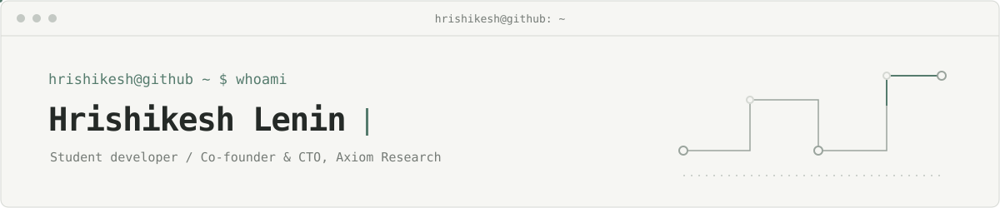

<div align="center">



</div>

```text
hrishikesh@github ~ $ whoami
Hrishikesh Lenin
Student developer · Co-founder & CTO at Axiom Research
I build software for research, learning, and developer tools.
```

```text
hrishikesh@github ~ $ ls ./selected-work
```

| Project | What it does |
| --- | --- |
| [**Axiom Research**](https://github.com/HrishikeshLenin13/AxiomResearch) · [site](https://axiommain.vercel.app) | A student research platform with foundations lessons and pathways into research, mentoring, and volunteering. I lead its technical development.<br><sub>TypeScript · React · Vite</sub> |
| [**Slice**](https://github.com/HrishikeshLenin13/slice) | Python code-context analysis that follows symbol dependencies and flags when dynamic behavior limits a complete static slice.<br><sub>Python · AST analysis</sub> |
| [**AegisDB**](https://github.com/HrishikeshLenin13/AegisDB) | A C++20 relational engine with cost-based join planning, Volcano execution, indexing, MVCC, and ARIES recovery. The project includes benchmarks against SQLite.<br><sub>C++20 · SQL</sub> |
| [**CalcTutor**](https://github.com/HrishikeshLenin13/calctutor) | Interactive math lessons turn written problems into follow-along calculator key sequences, with a standalone calculator model.<br><sub>TypeScript · Next.js · React</sub> |
| [**Gradelarp**](https://github.com/HrishikeshLenin13/gradelarp) | A grade dashboard that separates school-reported marks from manual what-if and GPA planning, with history and local backups.<br><sub>TypeScript · Next.js · React</sub> |

```text
hrishikesh@github ~ $ cat ./toolbox.txt
```

**Languages**  Python · TypeScript · C++20 · SQL<br>
**Web**  React · Vite · Next.js<br>
**Interests**  Static analysis · Database internals · Research access · Educational software

```text
hrishikesh@github ~ $ ./links.sh
```

[GitHub](https://github.com/HrishikeshLenin13) · [Axiom Research](https://axiommain.vercel.app)
